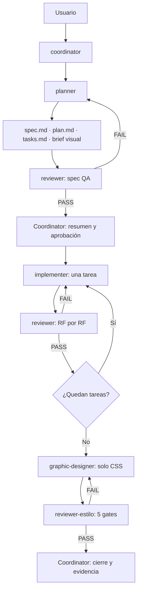

# AGENTS.md — Ecco / Muro 24h

Este archivo es el contrato compartido por todos los agentes del proyecto.
Léelo completo antes de actuar. Si una tarea entra en conflicto con este
archivo, detente y avisa al `coordinator`.

## 1. Cómo usar este archivo

Fuente de verdad, en este orden:

1. `AGENTS.md`: convenciones, reglas y flujo de trabajo.
2. `specs/<feature>/`: `spec.md`, `plan.md` y `tasks.md` de la feature activa. El brief visual global vive en `.opencode/design-brief.md`.
3. `db/migrations/` + `db/README.md`: esquema, invariantes y códigos de error.
4. `docs/`: contexto histórico, diagramas y borradores. **No es código de producción.**

Reglas de lectura:

- Documentación, specs, reviews y UI en **español**; identificadores, código y nombres de archivo en **inglés**.
- No inventes comandos, rutas ni dependencias. Si no existen, avisa al coordinator.
- Los subagentes no heredan la conversación. El coordinator debe pasarles rutas, tarea, criterios y comandos.
- Antes de implementar, lee `spec.md`, `plan.md` y la tarea asignada. No improvises reglas de negocio.
- Si una regla es ambigua, no la resuelvas por tu cuenta: repórtala al coordinator.
- No modifiques archivos fuera de tu rol. La matriz está en la sección 11.

## 2. Producto y estado actual

**Ecco** es un muro efímero de mensajes de solo texto:

- Cada usuario autenticado puede publicar un mensaje de texto.
- El mensaje vive exactamente **24 horas** y luego se borra.
- Durante esas 24 horas, otros usuarios pueden comentarlo.
- El mensaje con más comentarios se muestra como **héroe** del muro mientras sea el máximo.
- Los usuarios pueden reportar mensajes; los reportes quedan en cola de moderación.
- La lectura del muro es pública; publicar, comentar y reportar requiere sesión.

### Estado actual del repositorio

- **Fase 0 completada**: `db/migrations/001_schema.sql`, `db/migrations/002_cron.sql`, `db/tests/schema_test.sql` y scripts de validación.
- **Fase 1 completada (T01/T02)**: `package.json`, TS/ESLint/Prettier, `src/` con Fastify y `/healthz`, `Dockerfile`, `docker-compose.yml`, `db/Dockerfile`, `db/init/`, `Caddyfile`, `playwright.config.ts`, `vitest.config.ts` y tests de salud/API/DB.
- **Fase 2 completada (T03)**: registro, login, logout, `/me`, sesiones en BD con token sha256, Argon2id, cookies y rate limit.
- **T04 completada**: `GET /api/wall` y `GET /api/messages/:id` con lectura anónima, orden por comentarios, héroe dinámico, detalle y `410`.
- **T05 completada**: `POST /api/messages` autenticado, validación, moderación, 24 h, 409 de activo/duplicado y concurrencia.
- **T06 completada**: `POST /api/messages/:id/comments` con validación, moderación, 403/409/410, contador y concurrencia.
- **T07 completada**: `POST /api/messages/:id/report` con `pending`, 403/409/410/422 y cola privada.
- **T08 completada**: expiración filtrada en API, purga real con cascada, sesiones vencidas y reintento de deadlocks.
- **T09 completada**: shell React + Vite + TS, muro público con héroe, grid, countdown por `server_time`, estados de carga/vacío/error, contrato de clases y build de la SPA servido por Fastify.
- **No existe todavía**: detalle/comentarios/auth/reportes en UI, polling y specs visuales.
- **Entorno decidido**: PostgreSQL y app en Docker; el PostgreSQL local del 5432 no se usa. La base de Docker se publica en 5433, la app en 8080 y la app de test en 8081.
- `docs/` es referencia histórica:
  - `docs/init.sql` y `docs/codigo_base_de_datos_postgres.sql` están obsoletos; **no los uses**.
  - `docs/server.js` es un borrador, no la implementación de producción.
  - `docs/docker-compose.yml` usa una imagen (`cybertecpostgresql/postgresql:16-3`) que no está disponible públicamente.
- La siguiente tarea es **T10: detalle, comentarios, auth y reportes UI**.
- El paquete SDD inicial vive en `specs/001-muro-24h/`.

### Roadmap de referencia

| Fase | Objetivo |
|---|---|
| 0 | Esquema PostgreSQL, constraints, triggers y purga (completada) |
| 1 | Scaffold, Docker, migraciones, lint, typecheck y base Playwright/Vitest (completada; T01/T02) |
| 2 | Auth, sesiones en BD, cookies y rate limit (completada; T03) |
| 3 | API de muro, mensajes, comentarios, reportes y purga (completada; T04-T08) |
| 4 | Frontend: shell, muro, héroe, countdown y estados (T09 completada; T10-T11 pendientes) |
| 5 | Detalle, comentarios, reportes y pantallas de auth |
| 6 | Polling, revalidación y pulido de errores |
| 7 | Moderación, rate limit y endurecimiento |
| 8 | Suite Playwright: API, DB, E2E y visual |
| 9 | Documentación final, diagramas y despliegue |

## 3. Stack, arquitectura y carpetas

### Stack objetivo

- **Backend**: Node.js 22, Fastify 5, PostgreSQL 16, `pg`, Zod, Argon2, `@fastify/cookie`, `@fastify/rate-limit`, `@fastify/helmet`, `@fastify/static`.
- **Frontend**: React + Vite + TypeScript.
- **Estilos**: CSS plano centralizado en `web/css/style.css`. Sin Tailwind, CSS-in-JS, CSS Modules ni estilos inline.
- **Base de datos**: PostgreSQL 16 con `pgcrypto`, `citext`, `btree_gist` y `pg_cron`; `wall` para desarrollo y `wall_test` para tests. `pg_cron` solo apunta a `wall`.
- **Infraestructura**: Docker Compose con `db`, `migrate`, `app`, `app-test` y `caddy`; PostgreSQL en `localhost:5433`, app en `8080`, app-test en `8081`, Caddy en 80/443.
- **Testing**: Playwright en el host contra `http://localhost:8081` y `wall_test`; Vitest solo para funciones puras.
- **Tiempo real**: polling cada 15 s en el MVP; SSE/WebSocket queda fuera de alcance.

### Estructura objetivo

```text
ecco/
├── AGENTS.md
├── .opencode/
│   └── agents/
├── specs/
│   └── 001-muro-24h/
├── db/
│   ├── Dockerfile          # PostgreSQL 16 + pg_cron
│   ├── migrations/
│   ├── init/               # creación de wall_test
│   └── tests/
├── src/                    # backend Fastify
├── web/                    # frontend React + Vite
│   ├── css/style.css       # único archivo de estilos
│   ├── src/
│   └── STYLE_CONTRACT.md   # clases disponibles para el diseñador
├── tests/
│   ├── setup/              # migraciones, seeds y helpers
│   ├── api/                # Playwright request
│   ├── db/                 # Playwright + pg
│   ├── e2e/                # Playwright navegador
│   ├── visual/             # screenshots y regresión visual
│   └── unit/               # Vitest: funciones puras
├── scripts/                # validación y utilidades
├── docs/                   # referencia histórica
├── docker-compose.yml
├── Dockerfile
├── Caddyfile
├── vite.config.ts
├── playwright.config.ts
├── vitest.config.ts
├── .env.example
└── package.json
```

La estructura exacta puede evolucionar; la spec y el plan de la feature mandan.

## 4. Reglas de negocio

### Requisitos funcionales

| ID | Regla | Criterio verificable |
|---|---|---|
| RF-01 | Lectura pública, escritura autenticada | `GET /api/wall` y `GET /api/messages/:id` funcionan sin sesión; publicar, comentar y reportar requieren cookie válida |
| RF-02 | Mensaje solo texto, 1–500 caracteres | Se recorta; no puede quedar vacío; pasa por moderación; si no, `422` |
| RF-03 | Vida exacta de 24 h | `expires_at = created_at + interval '24 hours'`; después no aparece en el muro y la API responde `410` |
| RF-04 | Un solo mensaje activo por usuario | Un segundo mensaje solapado devuelve `409 already_has_active_message` |
| RF-05 | Sin contenido duplicado activo | Hash normalizado; si otro mensaje activo tiene el mismo contenido, `409 duplicate_message` |
| RF-06 | Comentarios 1–300; uno por usuario y mensaje | No se puede comentar el propio mensaje (`403`), uno vencido (`410`) ni dos veces (`409`) |
| RF-07 | El más comentado es el héroe | Solo si `comments_count > 0`; empate: el más reciente; ranking dinámico |
| RF-08 | Purga automática | `pg_cron` cada minuto; la app siempre filtra por `expires_at > now()` |
| RF-09 | Reportes | Uno por usuario y mensaje; no auto-reporte; no mensajes vencidos |
| RF-10 | Sesiones | 7 días, token hasheado en BD, cookie `HttpOnly`, logout revoca |

### Requisitos no funcionales

| ID | Regla |
|---|---|
| RNF-01 | Responsive desde 360 px; WCAG AA; foco visible; navegación por teclado; `prefers-reduced-motion` |
| RNF-02 | Polling cada 15 s con `server_time` y `ETag`; pausar cuando la pestaña está oculta |
| RNF-03 | Argon2 para contraseñas; Zod en bordes; SQL parametrizado; rate limit; sin contenido en logs |
| RNF-04 | Tiempos en UTC en la base; la UI muestra hora local y countdown calculado con `server_time` |
| RNF-05 | Sin imágenes, enlaces ni HTML en mensajes; solo texto plano |

### Fuera de alcance del MVP

- Verificación de email y recuperación de contraseña.
- Panel de administración de reportes.
- SSE/WebSocket.
- Edición o borrado de mensajes/comentarios.
- Notificaciones, multi-idioma, imágenes o adjuntos.
- Auto-ocultado automático por umbral de reportes (solo cola de revisión).

## 5. Datos, errores y API

### Datos

- Tablas: `users`, `sessions`, `messages`, `comments`, `reports`.
- `db/migrations/` es la única fuente de verdad del esquema.
- No edites tablas a mano ni modifiques `db/migrations` sin una tarea aprobada.
- Invariantes clave:
  - exclusión por intervalos: un mensaje activo por usuario y sin duplicados activos;
  - `content_hash` generado con `normalize_hash(content)`;
  - `expires_at` fijado por trigger y protegido contra updates;
  - `comments_count` sincronizado por trigger;
  - `reports` único por usuario/mensaje.
- Detalle completo: `db/README.md`.

### Códigos de error

| SQLSTATE / constraint | Código de aplicación | HTTP |
|---|---|---|
| `P0001` | `cannot_comment_on_own_message` | 403 |
| `EC001` | `message_gone` | 410 |
| `EC002` | `cannot_report_own_message` | 403 |
| `EC003` | `message_immutable` | 409 |
| `23P01` + `uq_messages_active_per_user` | `already_has_active_message` | 409 |
| `23P01` + `uq_messages_active_no_duplicates` | `duplicate_message` | 409 |
| `23505` + `uq_comments_one_per_user_message` | `already_commented` | 409 |
| `23505` + `reports_one_per_user_message` | `already_reported` | 409 |
| `23505` + `users_username_key` / `users_email_key` | `already_exists` | 409 |
| `23514` | `invalid_input` | 422 |

Formato de error de la API:

```json
{ "code": "message_gone", "message": "Este mensaje ya expiró" }
```

Los `issues` de Zod se añaden solo en errores `422`.

### API objetivo

| Método | Ruta | Auth | Respuesta |
|---|---|---|---|
| POST | `/api/auth/register` | — | 201, 409, 422 |
| POST | `/api/auth/login` | — | 200, 401 |
| POST | `/api/auth/logout` | cookie | 200 |
| GET | `/api/auth/me` | cookie | 200, 401 |
| GET | `/api/wall` | — | 200 + `server_time` + `is_top` |
| GET | `/api/messages/:id` | — | 200, 410 |
| POST | `/api/messages` | cookie | 201, 409, 422 |
| POST | `/api/messages/:id/comments` | cookie | 201, 403, 409, 410, 422 |
| POST | `/api/messages/:id/report` | cookie | 201, 409, 410, 422 |
| GET | `/healthz` | — | 200 |

Reglas de API:

- JSON, sin HTML.
- IDs: `bigint` en DB; la API los serializa como `number` dentro del rango seguro y los valida con Zod.
- Fechas ISO 8601 en UTC.
- `GET /api/wall` ordena por `comments_count DESC, created_at DESC` y marca el héroe.
- `GET /api/messages/:id` incluye comentarios ordenados por `created_at`.
- No expongas emails ni `password_hash`.
- No uses CORS con `*`; mismo origen.

## 6. Convenciones de código

### General

- TypeScript con `strict: true`. No uses `any` ni `@ts-ignore` sin justificación escrita.
- ESM (`"type": "module"`).
- Prettier + ESLint desde la fase 1. No reformatees archivos ajenos a la tarea.
- No añadas dependencias sin que el plan lo justifique.
- No uses `console.log` en producción; usa el logger de Fastify.
- Comentarios en español; identificadores en inglés.
- No dejes código muerto, TODOs sin dueño ni secretos.

### Backend

- Rutas Fastify modulares; validación Zod en el borde.
- Lógica de negocio en servicios; acceso a datos con `pg` y consultas parametrizadas.
- Un `error handler` central mapea errores de dominio y de PostgreSQL.
- No concatenes SQL. No uses `SELECT *` en respuestas públicas sin necesidad.
- Cookies: `HttpOnly`, `SameSite=Lax`, `Secure` en producción.
- Sesión: token aleatorio de 32 bytes; en BD solo su sha256 hex.
- Rate limit en auth, publicación, comentarios y reportes.
- Logs estructurados; nunca registres contenido de mensajes, tokens ni contraseñas.

### Frontend

- Componentes funcionales y hooks; sin clases.
- Un wrapper de `fetch` con manejo uniforme de errores y `credentials: "include"`.
- Estados explícitos: loading, empty, error, success.
- Accesibilidad primero: botones semánticos, labels, foco, teclado, `aria-live` para contadores.
- No uses `dangerouslySetInnerHTML`.
- No muestres contenido sin escapar; React ya escapa texto.
- No inventes estado global si el polling y el estado local alcanzan.

### Base de datos

- Cambios solo mediante migraciones numeradas.
- No edites `docs/` SQL ni lo uses como fuente.
- Usa `timestamptz`, `now()` y UTC.
- Los IDs son `bigint`; no los conviertas a `int`.
- Los tests de integración usan PostgreSQL real, no mocks de constraints.

## 7. Sistema visual y CSS

- El único archivo de estilos es **`web/css/style.css`**.
- Prohibido: Tailwind, CSS-in-JS, CSS Modules, estilos inline, `@import` a otros CSS y nuevos archivos CSS.
- El CSS se organiza por secciones: tokens, reset, layout, componentes, estados, utilidades, media queries.
- Tokens en `:root`: color, tipografía, espaciado, radios, sombras, transiciones.
- Nombres de clase semánticos tipo BEM: `wall`, `message-card`, `message-card--top`, `comment-form`, `countdown`.
- Mobile-first; breakpoints de referencia: 480, 768, 1024 px.
- Estados obligatorios: hover, focus-visible, active, disabled, loading, empty, error.
- Accesibilidad: contraste mínimo AA, foco visible, no depender solo del color, respetar `prefers-reduced-motion`.
- El implementer crea el markup y las clases; el `graphic-designer` **no toca JSX/TSX**.
- Si falta una clase o un hook visual, el diseñador lo reporta; el coordinator crea una tarea para el implementer.
- La estética se define en `.opencode/design-brief.md` (brief global). Si falta o está incompleto, el coordinator lo pide antes de invocar al diseñador. Si una feature necesita overrides, el planner puede crear `specs/<feature>/design-brief.md`.

## 8. Testing y comandos

### Estrategia

- **Runner principal**: Playwright Test para API, DB, E2E y visual.
- **API**: `request` de Playwright; auth, muro, mensajes, comentarios, reportes y códigos 401/403/409/410/422.
- **DB**: Playwright + `pg` para constraints, triggers, expiración, purga y concurrencia contra PostgreSQL real.
- **E2E**: navegador para publicar, comentar, ranking, sesión, errores y capturas.
- **Visual**: capturas 360/768/1280, estados y regresión.
- **Unitarios**: Vitest solo para funciones puras (Zod, moderación, mapeo, fechas).
- **SQL puro**: `./scripts/validate-schema.sh` y `./scripts/validate-cron.sh` siguen siendo la validación directa de PostgreSQL.
- **Tests primero** en el implementer: escribe el test que falla, implementa, ponlo en verde.
- No mockees la base de datos para validar constraints; usa el PostgreSQL real.
- No declares un test como pasado sin haberlo ejecutado.
- Evidencia: HTML report, trace, screenshot o vídeo en fallo.

### Comandos

```sh
./scripts/validate-schema.sh   # esquema + reglas + triggers + purga
./scripts/validate-cron.sh     # pg_cron real (hasta ~75 s)
```

Requieren `podman` o `docker` y el cliente `psql`.

```sh
docker compose up -d --build          # db + migrate + app + caddy
npm install
npm run build
npm run dev           # opcional: app en host con la DB en Docker
npm test              # Playwright: setup + api + db (+ e2e/visual cuando existan)
npm run test:up       # levanta db + migrate-test + app-test
npm run test:down
npm run test:api
npm run test:db
npm run test:e2e      # configurado; specs pendientes
npm run test:visual   # configurado; specs pendientes
npm run test:unit     # Vitest: funciones puras
npm run test:all      # test:up + unit + Playwright + test:down
npm run lint
npm run typecheck
npm run db:migrate
npm run db:migrate:test
```

Configuración Playwright: `playwright.config.ts` con proyectos `setup`, `api`,
`db`, `e2e` y `visual`; `baseURL` = `TEST_BASE_URL`
(`http://localhost:8081`); `TEST_DATABASE_URL` = `localhost:5433/wall_test`;
`migrate-test` aplica el esquema; `setup` valida el esquema y espera `/healthz`
de `app-test`; los seeds se añadirán con los tests de negocio; sin `webServer`
si el stack de test ya está levantado; traces, screenshots y vídeo solo en
fallo; `workers: 1` para `db`.

El script `test:all` levanta el perfil `test` (`test:up`), ejecuta Vitest y
Playwright, y baja el stack (`test:down`).

Si un comando no existe, no lo inventes ni lo uses como si funcionara.

### Entorno

- `.env` no se versiona; `.env.example` sí.
- Variables: `DB_PASSWORD`, `POSTGRES_PORT`, `APP_PORT`, `APP_TEST_PORT`, `TEST_BASE_URL`, `DATABASE_URL`, `TEST_DATABASE_URL`, `COOKIE_SECRET`, `TEST_COOKIE_SECRET`, `PORT`, `NODE_ENV`.
- `DATABASE_URL` y `TEST_DATABASE_URL` son para herramientas del host (`localhost:5433`); dentro de Docker se usa `db:5432`.
- El PostgreSQL local del 5432 no se usa en este proyecto.
- `TEST_DATABASE_URL` es exclusiva de tests; nunca apuntes a producción.
- MCP: `context7` para documentación de librerías; `playwright` para verificación visual. No pongas claves en el repositorio.

### Documentación con Context7

- Úsalo antes de implementar o actualizar una librería, plugin, SDK o CLI.
- Flujo: `resolve-library-id` → `query-docs` con la librería y versión exactas.
- Cita en el plan, handoff o evidencia la librería/versión y las decisiones tomadas.
- No lo uses para reglas de negocio ni para sustituir la lectura del código local.
- No incluyas claves, tokens ni datos sensibles en las queries.
- El `reviewer` puede usarlo para verificar compatibilidad de APIs.

## 9. Seguridad y privacidad

- Contraseñas con Argon2id.
- Sesión con token de 32 bytes; en BD solo sha256; cookie de 7 días.
- `HttpOnly`, `Secure` en producción, `SameSite=Lax`.
- CSRF: `SameSite` + comprobación de `Origin` en mutaciones.
- Rate limit por IP y por usuario en auth, publicación, comentarios y reportes.
- Validación Zod en todos los bordes; rechaza payloads inesperados.
- SQL siempre parametrizado.
- XSS: renderiza texto plano; nada de HTML del usuario.
- No registres contenido de mensajes, tokens, contraseñas ni emails.
- No expongas emails ni hashes.
- Errores 500 sin detalles internos al cliente.
- Reportes y moderación: no auto-ocultes sin decisión de producto.
- No ejecutes `sudo`, `rm -rf`, `git push`, `git reset --hard` ni `git clean -fd` desde un agente.
- No leas ni imprimas `.env`; usa `.env.example` para conocer los nombres.

## 10. Flujo SDD y artefactos

### Artefactos

```text
specs/<feature>/
├── spec.md             # problema, RF, RNF, casos borde, no-goals
├── plan.md             # arquitectura, datos, API, UI, fases, riesgos
├── tasks.md            # tareas atómicas con criterios y tests
└── evidence/
    ├── spec-review.md
    ├── T01-implementation-review.md
    ├── visual-review.md
    ├── playwright-report/
    ├── traces/
    └── screenshots/
```

Las reviews de implementación incluyen el reporte Playwright y los traces o
screenshots relevantes.

El brief visual global vive en `.opencode/design-brief.md`. Un
`design-brief.md` dentro de `specs/<feature>/` es un override opcional para esa
feature.

### Flujo



Reglas:

- Máximo **2 iteraciones** por gate; después el coordinator escala al usuario.
- El coordinator no implementa: orquesta, ejecuta comprobaciones y escribe evidencias.
- El implementer recibe **una sola tarea** por invocación.
- El reviewer valida RF por RF con evidencia, no impresiones.
- El rediseño visual es una fase aparte, solo si la feature toca UI.
- El coordinator pide aprobación tras la spec y antes del cierre, salvo autorización explícita de modo autónomo.
- Cada review se guarda en `evidence/`.
- Las decisiones que cambian alcance se registran en `spec.md` o `plan.md`.

### Plantilla de tarea

```markdown
### T01 — <título>
- RF: RF-03, RF-07
- Depende de: T00
- Archivos permitidos: ...
- Criterios de aceptación: ...
- Playwright: api | db | e2e | visual | unit
- Tests: ...
- Evidencia: ...
```

### Handoff al implementer

```markdown
Tarea: T01
Lee: AGENTS.md, specs/<feature>/{spec,plan,tasks}.md
Archivos permitidos: ...
Criterios: ...
Proyecto Playwright: api | db | e2e | visual | unit
Comandos: ...
Docs consultadas: ...
Restricciones: no tocar web/css/style.css, no cambiar la spec, no añadir dependencias.
Devuelve: resumen, archivos, tests ejecutados, evidencia y bloqueos.
```

### Handoff al reviewer

```markdown
Modo: spec | implementation
Objetivo: ...
RF a validar: ...
Evidencia: ...
Docs consultadas: ...
Devuelve: PASS/FAIL por RF, severidad, hallazgos, comandos ejecutados.
```

### Handoff visual

```markdown
Brief: .opencode/design-brief.md
       (o el override specs/<feature>/design-brief.md)
Rutas: ...
Baseline: ...
Archivo permitido: web/css/style.css
Devuelve: diff, screenshots, tokens, notas de accesibilidad y hooks necesarios.
```

## 11. Subagentes, permisos y handoffs

| Agente | Modo | Puede editar | No puede editar | Salida |
|---|---|---|---|---|
| `coordinator` | primary | `specs/**` (estado/evidencia) y `MEMORY.md` | Código, tests, CSS, migraciones | Handoffs, aprobaciones, resumen |
| `planner` | subagent | `specs/**` y `.opencode/design-brief.md` | Código, tests, CSS | Spec, plan, tareas, brief |
| `reviewer` | subagent | Nada | Todo | Veredicto y hallazgos por RF |
| `implementer` | subagent | `src/**`, `web/**` (excepto CSS), `db/**`, `tests/**`, config | Specs, CSS, `docs/`, `AGENTS.md` | Código, tests y evidencia |
| `graphic-designer` | subagent | Solo `web/css/style.css` | Markup, TS, tests, otros CSS | CSS y capturas |
| `reviewer-estilo` | subagent | Nada | Todo | 5 gates PASS/FAIL |

Reglas de colaboración:

- El coordinator puede invocar solo a `planner`, `reviewer`, `implementer`, `graphic-designer` y `reviewer-estilo`.
- El coordinator no edita código ni CSS.
- El planner no ejecuta código ni toca tests.
- El implementer no toca CSS ni la spec.
- El graphic-designer no toca markup, TS, tests ni otros CSS.
- El reviewer y el reviewer-estilo son estrictamente de solo lectura.
- Si un agente necesita un archivo fuera de su permiso, se detiene y lo reporta.
- No hay preguntas directas al usuario desde subagentes; el coordinator centraliza.
- Un subagente que no puede completar la tarea devuelve `BLOQUEADO` con motivo y evidencia.

## 12. Gates, DoR y DoD

### Gate de spec

- RF claros, testeables y sin contradicciones.
- Casos borde y no-goals explícitos.
- Consistencia con `AGENTS.md`, `db/README.md` y el esquema.
- Tareas atómicas, ordenadas y con tests.
- Seguridad, accesibilidad y rendimiento considerados.
- Brief visual si hay UI.

### Gate de implementación

- Cada RF tiene evidencia (Playwright test, comando, captura).
- `npm run test:all` en verde contra `app-test` (8081) y `wall_test` (5433); scripts SQL si se tocó la BD.
- Reporte HTML, traces o screenshots guardados cuando aplique.
- Si la tarea usa una librería, la evidencia cita la documentación de Context7 consultada.
- Manejo de errores y códigos correctos.
- Sin scope creep ni archivos fuera de la tarea.
- Sin secretos, sin contenido en logs, sin `any` injustificado.
- Sin regresiones en flujos existentes.

### Gates visuales

1. **Integridad**: solo cambió `web/css/style.css`.
2. **Regresión**: la UI y los flujos siguen funcionando; capturas 360/768/1280.
3. **Estética**: coincide con el brief aprobado (`.opencode/design-brief.md` o el override); jerarquía, tipografía, color y espaciado.
4. **Accesibilidad**: contraste, foco visible, teclado, movimiento reducido, color no único.
5. **Limpieza**: sin CSS muerto, sin selectores duplicados, sin `!important` injustificado, tokens usados.

### Definition of Ready

- Spec revisada y aprobada.
- Tareas atómicas con RF, criterios, archivos y tests.
- Dependencias resueltas.
- Brief visual aprobado si hay UI.
- Comandos y entorno conocidos.

### Definition of Done

- Todos los RF en PASS.
- Tests Playwright y unitarios verdes; evidencia guardada.
- Reviewer en PASS.
- Gates visuales en PASS si hubo UI.
- Sin scope creep, sin secretos y sin archivos ajenos.
- `tasks.md` y `evidence/` actualizados.
- Build green y documentación actualizada.

### Condiciones de parada

- Dos iteraciones fallidas en un gate.
- Brief visual ausente o ambiguo.
- Spec contradictoria o incompleta.
- Entorno bloqueado o comando inexistente.
- Riesgo de seguridad o de pérdida de datos.

## 13. Colaboración y "no hacer"

- No implementes sin spec y plan aprobados.
- No edites archivos fuera de tu rol o de la tarea.
- No cambies reglas de negocio sin actualizar spec y migración.
- No añadas dependencias sin aprobación del plan.
- No uses `docs/` como fuente de código.
- No uses Tailwind, CSS-in-JS, CSS Modules ni estilos inline.
- No uses React Testing Library ni otro runner para API/DB/E2E; Playwright es el runner.
- No ejecutes Playwright contra producción; usa `TEST_DATABASE_URL`.
- No uses Context7 para reglas de negocio ni pegues claves o datos sensibles en las queries.
- No uses el PostgreSQL local del 5432 para este proyecto.
- No uses `localhost` dentro de un contenedor; usa `db:5432`.
- No ejecutes tests contra `wall`; usa `wall_test`.
- No apuntes `pg_cron` a `wall_test`; solo a `wall`.
- No migres los tests SQL a Playwright sin aprobación.
- No uses `dangerouslySetInnerHTML`.
- No leas ni imprimas `.env`; usa `.env.example`.
- No registres contenido de mensajes, tokens ni contraseñas.
- No ejecutes comandos destructivos ni `git push`.
- No inventes comandos, tests o resultados.
- No declares "hecho" sin evidencia.
- No hagas preguntas directas al usuario desde un subagente.
- No edites `opencode.json`, `AGENTS.md` ni `docs/` sin una tarea explícita.

## 14. Decisiones abiertas y enlaces

Decisiones cerradas:

- `coordinator` es primary; los otros cinco son subagentes.
- CSS plano centralizado en `web/css/style.css`.
- Artefactos SDD en `specs/<feature>/`.
- Brief visual global en `.opencode/design-brief.md`; overrides por feature en `specs/<feature>/design-brief.md` si hacen falta.
- Playwright es el runner de API/DB/E2E/visual; Vitest solo unitarios puros.
- Los tests de esquema y pg_cron siguen en SQL puro.
- Context7 es la fuente de documentación de librerías; Playwright para verificación visual.
- PostgreSQL y app en Docker; DB en `localhost:5433`, app en `8080`, app-test en `8081`.
- `wall` para desarrollo y `wall_test` para tests; `pg_cron` solo en `wall`.
- Playwright en el host contra `app-test`; Vitest solo unitarios.

Pendiente de decidir en el brief visual:

- Paleta, tipografía, densidad, radios, sombras y movimiento.
- Tema claro/oscuro o ambos.
- Referencias visuales y “do/don’t”.

Fuera del MVP: verificación de email, recuperación de contraseña, panel de administración, SSE/WebSocket, notificaciones, edición de comentarios e imágenes.

Enlaces:

- `db/README.md`: esquema, reglas y códigos de error.
- `db/migrations/001_schema.sql`: DDL vigente.
- `db/migrations/002_cron.sql`: purga automática.
- `docs/estructura.md`: contexto original.
- `docs/diagrama_entidad.png`, `docs/diagrama_secuencia.png`: diagramas de referencia.
- `specs/001-muro-24h/`: primer paquete SDD.
- `.opencode/design-brief.md`: brief visual global; es un documento, no un agente.
- `MEMORY.md`: estado operativo y decisiones recientes.

## 15. Memoria

- Al empezar, lee `MEMORY.md` para conocer el estado del proyecto y las decisiones tomadas.
- Al terminar una tarea, el coordinator actualiza `MEMORY.md`: estado actual, decisiones importantes (con su porqué) y errores a evitar.
- Mantenlo breve (máximo ~50 líneas): resume o elimina lo que ya no aporte.
- Si algo se convierte en una regla permanente, propón moverlo a `AGENTS.md` en lugar de dejarlo en la memoria.
- No guardes nunca datos sensibles (claves, tokens, datos personales).

---

Si una instrucción de este archivo no se puede cumplir, detente y reporta el
conflicto al `coordinator` antes de continuar.
