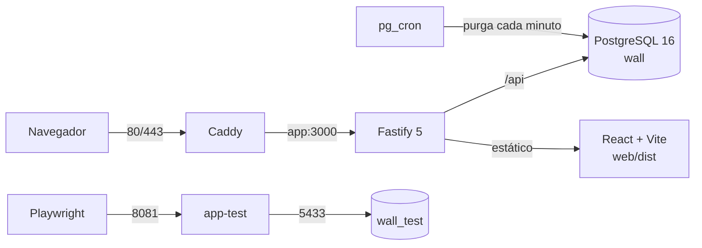

# Ecco — Muro 24h

Muro efímero de mensajes de solo texto: cada mensaje vive **24 horas**, recibe
comentarios y el más comentado se convierte en el héroe del muro.

> Repositorio: <https://github.com/franmaurizpereira/wall24h>
>
> Estado: **MVP completo** (T00-T14 + V01). La API, la SPA, el polling, el
> hardening y la suite Playwright están implementados. La medición de métricas
> DORA queda como siguiente línea de trabajo, fuera del MVP.

## Qué es

- Lectura pública; publicar, comentar y reportar requiere sesión.
- Mensajes de solo texto, 1–500 caracteres.
- Vida exacta de 24 horas; después desaparecen del muro y la API responde `410`.
- Un solo mensaje activo por usuario y sin contenido activo duplicado.
- Un comentario por usuario y mensaje; no se puede comentar el propio mensaje.
- El mensaje con más comentarios es el **héroe**; empate por fecha más reciente.
- Reportes en cola de moderación, sin panel de administración.
- Purga automática con `pg_cron` cada minuto.

## Arquitectura



- **Backend**: Node.js 22, Fastify 5, `pg`, Zod, Argon2, Helmet y rate limit.
- **Frontend**: React 19 + Vite + TypeScript; CSS plano en `web/css/style.css`.
- **Base de datos**: PostgreSQL 16 con `pgcrypto`, `citext`, `btree_gist` y
  `pg_cron`.
- **Infraestructura**: Docker Compose con `db`, `migrate`, `app`, `app-test`,
  `migrate-test` y `caddy`.
- **Testing**: Playwright para API, DB, E2E y visual; Vitest para funciones
  puras; SQL puro para esquema y `pg_cron`.

## Arranque rápido

Requisitos: Docker con Compose v2, Git y Node.js 22 (solo para tests/scripts
del host).

```sh
git clone git@github.com:franmaurizpereira/wall24h.git
cd wall24h
cp .env.example .env

# Edita .env: DB_PASSWORD, COOKIE_SECRET y TEST_COOKIE_SECRET.
docker compose up -d --build
curl http://localhost:8080/healthz
```

Abre `http://localhost:8080`. La SPA se sirve desde Fastify y las rutas del
cliente (`/messages/:id`) usan el fallback de `index.html`.

Para desarrollo del frontend con recarga en caliente:

```sh
npm install
npm run dev       # API en http://localhost:3000
npm run dev:web   # Vite en http://localhost:5173 (proxy /api → 8080)
```

## Docker y puertos

| Servicio | Puerto host | Base / función |
|---|---|---|
| `db` | `5433` | `wall` (desarrollo) y `wall_test` (tests) |
| `migrate` | — | Aplica esquema y cron a `wall` |
| `migrate-test` | — | Recrea `wall_test` y aplica el esquema |
| `app` | `8080` | App principal con `wall` |
| `app-test` | `8081` | App de tests con `wall_test` |
| `caddy` | `80/443` | Reverse proxy y TLS |

- El PostgreSQL local del `5432` no se usa en este proyecto.
- Dentro de Docker, la app usa `db:5432`; desde el host, `localhost:5433`.
- `pg_cron` solo apunta a `wall`; `wall_test` prueba las funciones de purga
  directamente.
- `app` y `app-test` usan la misma imagen multi-stage; incluye la SPA compilada.

### Perfil de test

```sh
docker compose --profile test up -d     # db + migrate-test + app-test
npm test                                # Playwright completo
npm run test:down
```

El atajo `npm run test:all` levanta el perfil, ejecuta Vitest y Playwright y lo
baja. Requiere Docker Compose disponible en el host.

## Variables de entorno

| Variable | Uso |
|---|---|
| `NODE_ENV` | `development`, `test` o `production`. En producción activa cookies `Secure` y CSP con upgrade. |
| `PORT` | Puerto interno de Fastify; por defecto `3000`. |
| `POSTGRES_PORT` | Puerto host de PostgreSQL; por defecto `5433`. |
| `APP_PORT` | Puerto host de la app; por defecto `8080`. |
| `APP_TEST_PORT` | Puerto host de `app-test`; por defecto `8081`. |
| `TEST_BASE_URL` | Base de Playwright; por defecto `http://localhost:8081`. |
| `DB_PASSWORD` | Password del usuario `wall`; solo caracteres URL-safe. |
| `DATABASE_URL` | Conexión host a `wall` (`localhost:5433`). |
| `TEST_DATABASE_URL` | Conexión host a `wall_test`; nunca producción. |
| `COOKIE_SECRET` | Secreto de cookie de desarrollo. |
| `TEST_COOKIE_SECRET` | Secreto de cookie de tests. |
| `APP_ORIGIN` | Origen(es) permitido(s) para mutaciones, separados por coma. |
| `TRUST_PROXY` | `true` detrás de Caddy para usar `X-Forwarded-*`; `false` en directo. |
| `MODERATION_BANNED_WORDS` | Palabras extra separadas por coma. |
| `LOG_LEVEL` | Nivel de logs de Fastify (`info` por defecto). |

`.env` no se versiona. Usa `.env.example` como plantilla y no subas secretos.
En producción, `APP_ORIGIN` debe ser el origen HTTPS real y `TRUST_PROXY=true`
si Caddy está delante.

## Migraciones

`db/migrations/001_schema.sql` es la fuente de verdad del esquema;
`db/migrations/002_cron.sql` registra los jobs de purga.

- `docker compose up -d` ejecuta `migrate` y aplica esquema + cron a `wall`.
- `migrate-test` **recrea** `wall_test` en cada ejecución y aplica solo el
  esquema; no programa cron.
- `npm run db:migrate` y `npm run db:migrate:test` ejecutan los mismos scripts
  desde el host usando `DATABASE_URL` y `TEST_DATABASE_URL`.
- No hay migraciones “down”. Antes de una migración en producción:
  1. Haz backup.
  2. Aplica `migrate`.
  3. Comprueba `/healthz` y los logs.
  4. Si falla, restaura el backup y vuelve a la imagen anterior.

## Testing

```sh
npm test              # Playwright: setup + e2e + api + db + visual
npm run test:api      # /healthz + auth + muro + mensajes + comentarios + reportes + hardening
npm run test:db       # esquema, constraints, concurrencia y expiración
npm run test:e2e      # muro, auth, detalle, publicación, reportes y polling
npm run test:visual   # snapshots 360/768/1280
npm run test:unit     # Vitest: formatos y logs seguros
npm run test:all      # test:up + unit + Playwright + test:down
npm run test:up
npm run test:down
```

- Playwright corre en el host contra `app-test` (`http://localhost:8081`) y
  `wall_test` (`localhost:5433`).
- Suite actual: **68 tests Playwright** (setup 1, E2E 20, API 36, DB 8, visual 3)
  y **6 tests unitarios**.
- Orden: `setup → e2e → api → db → visual`; el rate limit de login se prueba
  después de E2E para no bloquear el flujo de auth.
- Snapshots en `tests/visual/wall.spec.ts-snapshots/`; capturas editoriales en
  `specs/001-muro-24h/evidence/screenshots/`.
- Evidencia: `specs/001-muro-24h/evidence/`, incluido
  `playwright-report/index.html`.

### Validar la base de datos

Requiere `podman` o `docker` y el cliente `psql`:

```sh
./scripts/validate-schema.sh   # esquema, reglas, triggers y purga
./scripts/validate-cron.sh     # pg_cron real (hasta ~75 s)
```

## Despliegue

Guía ampliada: [`docs/despliegue.md`](docs/despliegue.md).

1. DNS del dominio apuntando al host.
2. `.env` de producción:

   ```sh
   NODE_ENV=production
   TRUST_PROXY=true
   APP_ORIGIN=https://wall24h.tudominio.com
   COOKIE_SECRET=<secreto-de-32+-caracteres>
   DB_PASSWORD=<password-url-safe>
   ```

3. En `Caddyfile`, comentar el bloque `:80` y activar el dominio de
   producción. Caddy obtiene el certificado automáticamente.
4. Abrir solo `80/443` en el firewall. No expongas públicamente `8080`,
   `8081` ni `5433`.
5. Desplegar:

   ```sh
   docker compose up -d --build
   curl https://wall24h.tudominio.com/healthz
   docker compose logs -f app
   ```

6. Backup antes de migrar:

   ```sh
   docker compose exec -T db pg_dump -U wall -d wall -Fc > backup-wall.dump
   ```

### Limitaciones conocidas

- Rate limit en memoria por instancia. Con varias réplicas hace falta Redis u
  otro store compartido.
- No hay panel de moderación; los reportes se consultan por SQL:

  ```sql
  SELECT id, message_id, reporter_id, reason, status, created_at
  FROM reports
  WHERE status = 'pending'
  ORDER BY created_at ASC;
  ```

- No hay verificación de email, recuperación de contraseña, edición/borrado de
  mensajes, SSE/WebSocket ni auto-ocultado por reportes.
- `NODE_ENV=production` usa cookies `Secure`: la app debe servirse por HTTPS.
- Las migraciones no tienen rollback automático; requiere backup/restore.
- El `Caddyfile` de producción es manual; no hay CI/CD ni métricas DORA
  automatizadas todavía.

## Estructura

```text
wall24h/
├── AGENTS.md
├── MEMORY.md
├── README.md
├── package.json
├── package-lock.json
├── tsconfig.json
├── vite.config.ts
├── playwright.config.ts
├── vitest.config.ts
├── eslint.config.js
├── .prettierrc
├── .env.example
├── .gitignore
├── Dockerfile
├── docker-compose.yml
├── Caddyfile
├── .opencode/
│   ├── agents/
│   └── design-brief.md
├── specs/001-muro-24h/
├── db/
│   ├── Dockerfile
│   ├── init/
│   ├── migrations/
│   ├── tests/
│   └── README.md
├── src/
│   ├── server.js
│   ├── app.js
│   ├── db.js
│   ├── routes/
│   └── lib/
├── web/
│   ├── index.html
│   ├── css/style.css
│   ├── src/
│   └── STYLE_CONTRACT.md
├── tests/
│   ├── setup/
│   ├── api/
│   ├── db/
│   ├── e2e/
│   ├── visual/
│   └── unit/
├── scripts/
│   ├── validate-schema.sh
│   ├── validate-cron.sh
│   ├── migrate.sh
│   ├── migrate-test.sh
│   ├── test-up.sh
│   ├── test-down.sh
│   ├── test-all.sh
│   └── with-env.mjs
└── docs/
```

## Roadmap

| Fase | Objetivo | Estado |
|---|---|---|
| 0 | Esquema PostgreSQL, constraints, triggers y purga | ✅ |
| 1 | Scaffold, Docker, migraciones, lint, typecheck y base de tests | ✅ |
| 2 | Auth, sesiones en BD, cookies y rate limit | ✅ |
| 3 | API de muro, mensajes, comentarios, reportes y purga | ✅ |
| 4 | Frontend: shell, muro, héroe, countdown y estados | ✅ |
| 5 | Detalle, comentarios, reportes y auth | ✅ |
| 6 | Polling, revalidación y pulido | ✅ |
| 7 | Moderación, rate limit y hardening | ✅ |
| 8 | Suite Playwright: API, DB, E2E y visual | ✅ |
| 9 | Documentación, diagramas y despliegue | ✅ |
| V01 | Rediseño visual editorial oscuro | ✅ |
| DORA | Medición y optimización de métricas DORA | ⏳ plan separado |

## Documentación

- `AGENTS.md`: reglas de producto, arquitectura, permisos y flujo de agentes.
- `MEMORY.md`: estado operativo y decisiones recientes.
- `specs/001-muro-24h/`: spec, plan, tareas y evidencias.
- `db/README.md`: esquema, reglas y códigos de error.
- `docs/despliegue.md`: guía operativa de producción.
- `docs/`: contexto histórico y diagramas originales; no es fuente de código.

## Seguridad

- Contraseñas con Argon2id; sesiones de 32 bytes con sha256 en BD.
- Cookies `HttpOnly`, `SameSite=Lax` y `Secure` en producción.
- CSP estricta con Helmet, `Origin` en mutaciones y rate limit por sesión/IP.
- Zod en los bordes, SQL parametrizado y moderación normalizada.
- Logs sin contenido, tokens, contraseñas ni parámetros SQL.
- Sin secretos en el repositorio; `.env` está ignorado.
