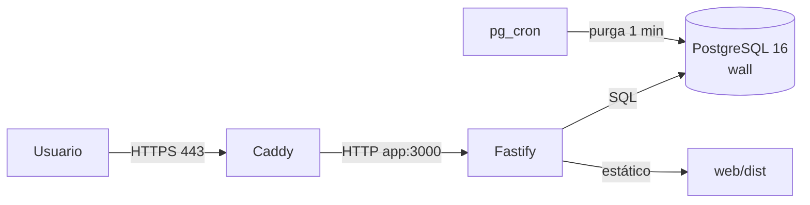

# Despliegue de Ecco / Muro 24h

Guía operativa para un despliegue de producción con Docker Compose, PostgreSQL
y Caddy. El objetivo es una sola instancia; las limitaciones están al final.

## Arquitectura



- `db`: PostgreSQL 16 con `pgcrypto`, `citext`, `btree_gist` y `pg_cron`.
- `migrate`: aplicación única de esquema y cron.
- `app`: Fastify + SPA compilada.
- `caddy`: TLS automático y reverse proxy.

## Requisitos

- Docker 24+ con Compose v2.
- Dominio con DNS apuntando al host.
- Puertos 80 y 443 abiertos.
- Node.js 22 solo si se ejecutan tests o scripts desde el host.

## 1. Configurar `.env`

Parte de `.env.example` y rellena valores reales:

```sh
NODE_ENV=production
TRUST_PROXY=true
APP_ORIGIN=https://wall24h.tudominio.com
ADMIN_USERNAMES=admin,moderador

DB_PASSWORD=<password-url-safe>
COOKIE_SECRET=<secreto-de-32+-caracteres>
TEST_COOKIE_SECRET=<otro-secreto>

POSTGRES_PORT=5433
APP_PORT=8080
APP_TEST_PORT=8081
DATABASE_URL=postgresql://wall:<password>@localhost:5433/wall
TEST_DATABASE_URL=postgresql://wall:<password>@localhost:5433/wall_test
```

Notas:

- `DB_PASSWORD` debe ser URL-safe para no romper las URLs.
- `TRUST_PROXY=true` es necesario detrás de Caddy para que el rate limit use
  `X-Forwarded-For`.
- `APP_ORIGIN` debe coincidir exactamente con el origen HTTPS.
- `ADMIN_USERNAMES` es la allowlist del panel `/admin`; sin ella nadie es
  administrador. Reinicia la app al cambiarla.
- Con `NODE_ENV=production`, las cookies son `Secure`; sin HTTPS no funcionará
  el login.

## 2. Configurar Caddy

En `Caddyfile`, comenta el bloque local `:80` y activa el dominio:

```caddyfile
wall24h.tudominio.com {
    encode zstd gzip
    reverse_proxy app:3000
}
```

Caddy gestiona el certificado con Let's Encrypt. No publiques `8080`, `8081`
ni `5433` al exterior; solo Caddy necesita 80/443.

## 3. Desplegar

```sh
docker compose up -d --build
docker compose ps
curl -fsS https://wall24h.tudominio.com/healthz
```

Orden de arranque:

1. `db` y su healthcheck.
2. `migrate` aplica `001_schema.sql` y `002_cron.sql`.
3. `app` arranca y Caddy lo publica.

Logs:

```sh
docker compose logs -f app
docker compose logs -f caddy
```

## 4. Verificar

```sh
curl -fsS https://wall24h.tudominio.com/healthz
curl -fsS https://wall24h.tudominio.com/api/wall
```

- Abre la SPA en el dominio.
- Registra un usuario de prueba y comprueba login, publicación y comentario.
- Comprueba las cabeceras de seguridad (`CSP`, `nosniff`, `X-Frame-Options`).
- Comprueba que una petición con `Origin: https://evil.example` devuelve 403.
- Revisa que los logs no contienen cuerpos ni cookies.

## 5. Migraciones y backups

Antes de cada despliegue con migraciones:

```sh
docker compose exec -T db pg_dump -U wall -d wall -Fc > backup-wall-$(date +%F-%H%M).dump
docker compose up -d --build
```

Restauración (con la app parada):

```sh
docker compose stop app
docker compose exec -T db pg_restore -U wall -d wall --clean --if-exists < backup-wall.dump
docker compose start app
```

No hay migraciones “down”; el rollback de esquema es restaurar el backup.

## 6. Actualización y rollback

Actualización normal:

```sh
git fetch --tags
git checkout <tag-o-commit>
docker compose up -d --build
curl -fsS https://wall24h.tudominio.com/healthz
```

Rollback de aplicación:

```sh
git checkout <tag-anterior>
docker compose up -d --build
```

Si la migración cambió el esquema, restaura también el backup.

## 7. Tests antes de desplegar

Con el perfil de test:

```sh
docker compose --profile test up -d
npm test
npm run test:unit
docker compose --profile test down
```

O el atajo:

```sh
npm run test:all
```

Validación SQL:

```sh
./scripts/validate-schema.sh
./scripts/validate-cron.sh
```

## 8. Moderación

Los usuarios incluidos en `ADMIN_USERNAMES` ven **Moderación** en la cabecera y
pueden abrir `/admin`.

- Lista reportes `pending` con mensaje, autor y motivo.
- **Revisado** y **Accionado** actualizan el estado y guardan auditoría.
- **Ocultar** hace soft-hide (`hidden_at`): retira el mensaje del muro/detalle,
  bloquea comentarios/reportes y conserva la evidencia.
- No hay auto-ocultado por umbral.

Si el panel no está disponible, revisa por SQL:

```sql
SELECT id, message_id, reporter_id, reason, status, created_at
FROM reports
WHERE status = 'pending'
ORDER BY created_at ASC;
```

## 9. Limitaciones

- **Una instancia**: el rate limit vive en memoria. Para escalar horizontalmente
  hace falta Redis u otro store compartido.
- **Panel mínimo**: no hay historial de acciones, edición de mensajes ni
  auto-ocultado.
- **Sin CI/CD**: el despliegue es manual. Las métricas DORA necesitan un
  pipeline e instrumentación aparte.
- **Sin rollback de migraciones**: backup/restore.
- **Sin verificación de email, recuperación de contraseña, SSE ni edición de
  mensajes.**
- **Puertos**: `5433`, `8080` y `8081` son de desarrollo/test; no deben
  publicarse en producción.
- **Backups**: programa `pg_dump` fuera de este repositorio y prueba la
  restauración periódicamente.

## 10. Checklist de producción

- [ ] DNS apunta al host.
- [ ] `.env` con secretos fuertes y `NODE_ENV=production`.
- [ ] `APP_ORIGIN` y `TRUST_PROXY` correctos.
- [ ] Caddy con dominio real y TLS.
- [ ] Firewall: solo 80/443.
- [ ] `docker compose up -d --build` sin errores.
- [ ] `/healthz` y `/api/wall` responden.
- [ ] Registro, login, publicación, comentario y reporte probados.
- [ ] `ADMIN_USERNAMES` configurado y `/admin` probado con un reporte.
- [ ] Ocultar un mensaje y comprobar que desaparece del muro y bloquea acciones.
- [ ] Cabeceras de seguridad y 403 de Origin comprobados.
- [ ] Backup inicial y restauración de prueba.
- [ ] Logs sin contenido sensible.
- [ ] `npm test` y `npm run test:unit` en verde.
